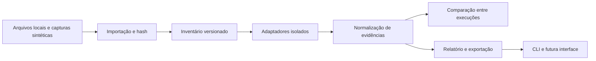

# Arquitetura: observações e proposta

## Modelos observados

Kali é uma camada de composição: metapacotes selecionam conjuntos de ferramentas e receitas live-build constroem imagens.
Wireshark separa aquisição (dumpcap), leitura de formatos (wiretap), dissecação (epan), interface gráfica (ui/qt) e CLI (tshark).
A análise de chamadas registrada liga TShark a EPAN; as demais camadas são um mapa orientado pelas fontes e ainda precisam de rastreamento completo.
Hydra tem um núcleo C que registra serviços e mantém retomada; a inspeção desta entrega não percorreu todos os módulos.
Os identificadores K01–H03 do ledger sustentam o recorte observado.

## Produto proposto: laboratório de evidências offline

Oportunidade hipotética: reunir proveniência, comparação de sessões e relatórios reproduzíveis numa experiência em português.
Começar com arquivos e capturas já existentes, com conectores opcionais e contratos explícitos.

O diagrama é uma proposta; consulta dos inventários, verificação dos artefatos, importação/comparação offline Nmap XML e exportação JSON/HTML estão implementadas nesta etapa.

## Contratos propostos

- Artifact: identificador, SHA-256, tamanho, formato e proveniência.
- AnalysisRun: ferramenta, versão, parâmetros, entradas, saídas, horários e estado.
- Finding: observação/inferência/hipótese, evidências, cobertura e perguntas abertas.
- Adapter: aceitar artefato local; produzir JSON validado; declarar dependências e efeitos.

## Decisões iniciais

- ADR-001: preservar fonte upstream separadamente; não misturar código copyleft em um núcleo próprio MIT.
- ADR-002: primeiro produto focado em análise offline; não construir uma distribuição Linux no MVP.
- ADR-003: resultados devem distinguir observação, derivação e hipótese; sem pontuações de confiança inventadas.
- ADR-004: primeiro conector de tráfego será um processo separado TShark; a fronteira de processo não decide sozinha as obrigações de licença.
- ADR-005: Hydra é referência de arquitetura nesta fase. Não há executor de autenticação ou credenciais no núcleo inicial.

As decisões são opções de projeto, não requisitos extraídos nem validação de vantagem competitiva.

## Adaptador offline implementado

`workbench.py import-nmap` recebe um arquivo local, chama `nmap_report.import_report` e retorna um JSON v1 ou cria um novo arquivo de saída.
O adaptador lê até 32 MiB, recusa construções XML não suportadas, calcula SHA-256, preserva campos selecionados e explicita cobertura e omissões.
A identidade da análise depende do hash e da versão do adaptador; não representa uma nova execução do Nmap.
Nmap e sqlmap continuam como referências externas; nenhum motor é empacotado ou chamado pelo adaptador.
Os detalhes observados das novas fontes e as escolhas de projeto estão separados em `NMAP-SQLMAP.md`.

## Comparação e relatório implementados

`compare-nmap` importa os dois XMLs com `nmap_report`, passa os registros à função pura `nmap_compare.compare_reports` e grava JSON e/ou a projeção `render_html`.
A lógica de pareamento e cobertura pertence ao comparador; o HTML apenas apresenta seu resultado e suas referências.
As correspondências usam IPs canônicos em relação única. Ambiguidades, versões, conclusão e cobertura acompanham as diferenças.
A ausência de um registro não vira um estado inferido; alterações em detecção de serviço não viram confirmação de atualização ou vulnerabilidade.
O identificador considera os hashes e versões de importação/comparação. Caminhos locais não participam da identidade por conteúdo.
A geração HTML não depende de JavaScript ou recursos externos; dados do XML são escapados e os links são internos ao relatório.

## John: referência de contratos e composição

A leitura seletiva do John identificou um contrato de formato versionado (`FMT_MAIN_VERSION`), registro em `formats.c`/`john.c` e persistência em `recovery.c`.
Esses pontos reforçam a separação entre contrato do adaptador, registro de módulos e estado de execução na arquitetura própria.
O catálogo lexical da pesquisa guarda declarações do fonte; um futuro catálogo de capacidades de runtime deverá registrar build, plataforma e evidências de observação separadamente.
Nenhum algoritmo do John, motor de processamento de senhas ou integração de execução foi incorporado nesta etapa. Os detalhes e fontes estão em `JOHN-THE-RIPPER.md`.

## Diretório e pesquisa de assistentes

`research_catalog` oferece buscas locais sobre metadados retidos e candidatos de pacotes. O gerador lê curadoria, metadados e lock; o catálogo não é um executor de ferramentas.
A implementação preserva a diferença entre fonte coletada e capacidade observada, incluindo gitlinks ausentes e análises parciais.
As fontes selecionadas fornecem referências de contratos de extensões, representação de fluxos, relatórios e importação; não houve incorporação de seus motores.
A pesquisa Gemini diferencia a observação pública do app dos componentes abertos CLI/SDK. Uma futura camada conversacional deve consumir evidências e adaptadores documentados; não está implementada nesta etapa.

## Fluxo de revisão implementado

`review` reutiliza o importador/comparador Nmap e o novo importador `trivy_report`, que valida o contrato selecionado de JSON v2 e não exporta conteúdos de categorias fora do recorte.
`review_rules.build_review` é uma função de regras determinísticas: fatos → justificativa + próxima verificação + referências. Não executa ações, não associa IPs a pacotes e não calcula risco do ambiente.
As regras pertencem a uma tabela identificada por versão e SHA-256. A identidade da revisão inclui artefatos e versões; fatos distintos da mesma fonte têm itens distintos.
`review_html` apresenta o resultado e sua cobertura, sem reinterpretar a severidade ou buscar recursos externos. O JSON e o HTML acompanham o mesmo resultado estruturado.
A função JSON de gravação existente é reutilizada e os destinos são conferidos antes da escrita. Os dados reais do usuário não são adicionados ao repositório pelos comandos.

## Terceiro produtor e validação comum

`zap_report` é o dono da interpretação dos códigos de risco/confiança, do tratamento estrutural de URIs e das contagens de instâncias selecionadas.
`json_reports` centraliza limite de bytes, decodificação UTF-8, rejeição de chaves duplicadas e validação textual compartilhada com Trivy. As regras específicas de cada formato ficam nos respectivos adaptadores.
A fila consome os fatos normalizados sem analisar riskdesc para decidir classificações. Regras v2 mantêm as evidências ZAP independentes de Nmap/Trivy e registram cobertura/diagnósticos sem executar ou republicar mensagens.
A API `build_review` aceita o novo produtor opcional; o esquema de saída permanece 1 e as versões/fingerprints distinguem as novas revisões.

## Aplicativo web local

`app/index.html`, `app/app.css` e `app/app.js` compõem a interface sem dependências de runtime no frontend. `scripts/app_server.py` fornece rotas HTTP limitadas a loopback, sessão local e CSRF. `app_service.py` coordena os adaptadores e a reprodução existentes; `app_store.py` persiste projetos, fontes, revisões, decisões, chat e estúdio com SQLite e consultas parametrizadas.

`app_chat.py` usa intenções e recuperação lexical; referências são dados estruturados clicáveis. `app_ai.py` acrescenta geração opcional por um Ollama local fixo, sem ferramentas, redirecionamentos ou execução de comandos. Texto recebido de fontes e modelos nunca é interpolado como HTML na interface.

`app_studio.py` mapeia arquivos ZIP em memória com orçamentos e hashes. `app_scaffold.py` gera um protótipo original por template, separando código fixo do texto do brief. O ZIP original não é retido, e nenhum conteúdo coletado é executado. O protótipo mantém dados no navegador; o aplicativo Atlas usa SQLite. Os limites de segurança e distribuição desta arquitetura são de uma aplicação local para um usuário, não um serviço multiusuário.
